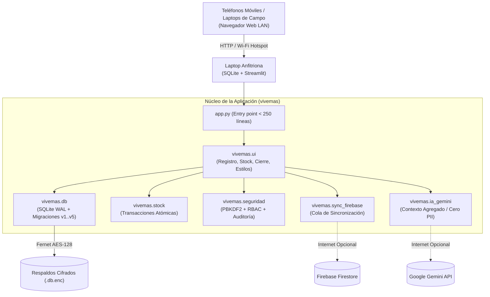

# Arquitectura de Software y Guía Técnica: Vive Más v2.0

## 1. Visión General del Sistema
**Vive Más** es una plataforma clínica y de farmacovigilancia comunitaria diseñada para operar en condiciones extremas de campo: sin conexión a internet estable, entornos con iluminación mínima (operación nocturna bajo toldos o carpas) y con alta demanda de atención rápida en dispositivos móviles y laptops interconectadas por red local (LAN / Hotspot Wi-Fi).

---

## 2. Estructura Modular del Paquete (`vivemas/`)

El sistema fue transformado de un monolito de ~3,500 líneas a una arquitectura modular desacoplada:

| Módulo | Responsabilidad |
|---|---|
| `vivemas.config` | Constantes, detección de rutas locales/PyInstaller, `class SS` (Session State centralizado) y secretos. |
| `vivemas.textos` | Normalización de fármacos (minúsculas, sin acentos, números unidos a unidades) y validación de identificadores anónimos. |
| `vivemas.diagnosticos` | Normalización clínica por expresiones regulares de palabra completa y explosión de comorbilidades. |
| `vivemas.exportes` | Sanitización contra inyección de fórmulas CSV/Excel (`= + - @`), exportador multi-hoja unificado y lector tabular robusto. |
| `vivemas.db` | Conexión SQLite en modo WAL, migraciones versionadas con `PRAGMA user_version` y respaldos automáticos cifrados con Fernet. |
| `vivemas.stock` | Cálculo de balance en tiempo real, movimientos compensatorios por anulación y vaciado/archivado transaccional. |
| `vivemas.seguridad` | Verificación PBKDF2-HMAC-SHA256 (600,000 iteraciones), control de acceso basado en roles (`campo` / `coordinador`) y bitácora de auditoría médica sin PII. |
| `vivemas.sync_firebase` | Sincronización con reintentos exponenciales, verificación instantánea de conectividad y propagación de eliminaciones. |
| `vivemas.ia_gemini` | Asistente epidemiológico Gemini con generación en stream y prompt agregado estrictamente libre de identificadores. |
| `vivemas.ui.*` | Módulos de interfaz: `estilos.py`, `componentes.py`, `sidebar.py`, `registro.py`, `stock_nuevo.py`, `control_stock.py`, `jornadas_anteriores.py`, `auditoria_ia.py` y `reportes.py`. |

---

## 3. Migraciones Versionadas de Base de Datos (`PRAGMA user_version`)

Para asegurar total idempotencia y compatibilidad sin pérdida de datos en bases de datos preexistentes o nuevas, SQLite almacena el número de versión en su metadato de usuario:

- **Versión 1:** Creación de tablas base (`registros_jornada`, `stock_donaciones`, `configuracion`, `control_seguridad`, `registro_auditoria`).
- **Versión 2:** Inclusión de columnas `uuid`, `sincronizado`, `nombre_jornada` y `tipo_registro` en `registros_jornada` con índices optimizados.
- **Versión 3:** Creación de `movimientos_stock` con índices por fármaco normalizado y tipo de movimiento.
- **Versión 4:** Inclusión de columna `archivado` para permitir vaciados de inventario sin borrar el historial de auditoría.
- **Versión 5:** Migración idempotente de entregas previas y normalización completa de nombres con `normalizar_nombre_farmaco`.

---

## 4. Invariantes de Seguridad y Privacidad

1. **Cero Secretos en Repositorio:** Ni contraseñas, ni API Keys, ni archivos de credenciales se almacenan en el código fuente. Se recuperan exclusivamente desde `.streamlit/secrets.toml` o variables de entorno.
2. **Cero Datos de Pacientes a la Nube / IA:** Las consultas a Gemini reciben únicamente métricas agregadas (totales numéricos, conteos por diagnóstico y distribución geográfica). Se bloquea la transmisión de `paciente_id`, edad individual o nombres.
3. **Cifrado en Reposo de Respaldos:** Si se configura `CLAVE_CIFRADO_BACKUP`, cada copia de seguridad generada (automática o manual) se cifra con Fernet (AES-128-CBC + HMAC-SHA256) bajo la extensión `.db.enc`.
4. **Protección contra Inyección de Fórmulas:** Toda exportación a Excel neutraliza caracteres ejecutables (`=`, `+`, `-`, `@`, tabulaciones) anteponiendo comilla simple protectora.
5. **Reautenticación con Doble Factor Cognitivo:** Las operaciones críticas (vaciado de inventario, archivado local y purga en la nube) exigen la contraseña del Coordinador y la escritura explícita de la palabra `BORRAR`.

---

## 5. Ergonomía y Experiencia de Usuario en Campo (UX)

- **Modos de Iluminación:**
  - *Luz Baja (Nocturno Campo):* Paleta profunda `#080303` con texto ámbar y rojo atenuado que previene la ceguera nocturna y ahorra batería.
  - *Modo Oscuro:* Alta legibilidad estándar para interiores.
  - *Alto Contraste:* Blanco y negro puro para visualización bajo luz solar directa.
- **Ergonomía Táctil:** Botones con altura mínima de 48px y tipografía de 16px para evitar el zoom involuntario en navegadores móviles (iOS Safari / Chrome Android).
- **Atención Rápida Multi-Fármaco:** Permite entregar hasta 3 medicamentos por paciente en una sola interacción, generando registros atómicos con validación transaccional inmediata (`BEGIN IMMEDIATE`).
- **Botones Rápidos:** Atajos táctiles de un solo toque para cantidades frecuentes (+10, +20 uds) y rangos de edad (Pediátrico, Adulto, Mayor).
- **Asistente Guiado de Cierre de Jornada:** Checklist interactivo que guía al coordinador en la conciliación de stock, creación de respaldo cifrado y generación del acta oficial multi-hoja.
